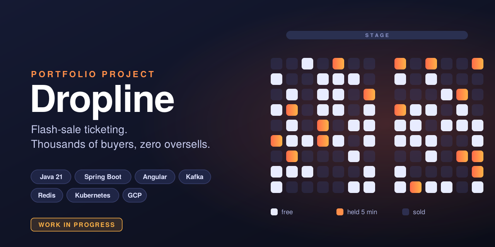
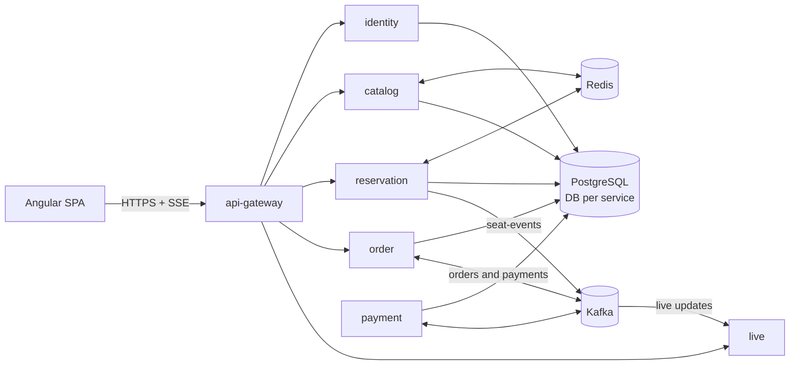

<div align="center">



# Dropline

**A ticket flash-sale platform where thousands of people grab a few seats at the same second, and nobody is ever double-sold.**


[](https://github.com/vnogueiras/dropline/actions/workflows/backend-ci.yml)
[](https://github.com/vnogueiras/dropline/actions/workflows/frontend-ci.yml)
[](https://github.com/vnogueiras/dropline/commits/main)


[Architecture](docs/architecture.md) · [Decisions](docs/adr/) · [Roadmap](#roadmap) · [Run it locally](#run-it-locally)

</div>

---

> 🚧 **Work in progress.** Dropline is being built in public, phase by phase. The checklist in the [roadmap](#roadmap) shows exactly what works today.

## The problem

At 10:00 a concert goes on sale. 200 seats, 5,000 people, all clicking **Hold** in the same second.

A naive system oversells, locks up its database, or shows people seats that are already gone. Dropline is a small product built around that one hard moment:

- 🔒 **No double booking**: seats are held atomically in Redis (all or none) and guarded again by a PostgreSQL unique index.
- 🔁 **A checkout that survives failure**: hold → order → payment → confirm or release, coordinated as a saga over Kafka with a transactional outbox.
- ⚡ **Live for everyone**: when a seat is taken, every open browser sees it turn grey within a second (Kafka → Server-Sent Events → Angular signals).
- 📈 **Built for the spike**: Redis caching and per-user rate limiting at the edge, and autoscaling on Kubernetes.

The goal: a load test with **2,000 virtual users, 200 seats → exactly 200 sold, 0 oversold.**

## Architecture



| Service | Responsibility |
|---|---|
| **api-gateway** | Single entry point: routing, JWT check, rate limiting |
| **identity-service** | Users, roles, hashed passwords, issues JWTs (Spring Authorization Server) |
| **catalog-service** | Events, venues, price tiers, events calendar |
| **reservation-service** | Atomic seat holds with a 5-minute expiry |
| **order-service** | Orders and the checkout saga (transactional outbox) |
| **payment-service** | Mock payment provider that is sometimes slow and sometimes fails, on purpose |
| **live-service** | Pushes seat and order updates to browsers |

👉 Full design, checkout sequence diagram, Kafka topics and Redis patterns: **[docs/architecture.md](docs/architecture.md)**. Why things are the way they are: **[docs/adr/](docs/adr/)**.

## Tech stack

| Layer | Tech |
|---|---|
| **Backend** | Java 21 · Spring Boot 4 · Spring Data JPA · Spring Kafka · Spring Security + Authorization Server · Maven multi-module |
| **Frontend** | Angular (standalone, zoneless) · Signals + `httpResource` · Angular Material · Tailwind CSS |
| **Data** | PostgreSQL 17 (database per service, Flyway) · Redis (holds, cache, rate limiting, pub/sub) |
| **Messaging** | Apache Kafka in KRaft mode · transactional outbox · dead-letter topics |
| **Infra** | Docker Compose · Kubernetes (GKE) · Helm · Strimzi · Terraform |
| **GCP** | GKE · Cloud Storage · Cloud Run functions · Secret Manager · Cloud Scheduler · Cloud Logging/Trace |
| **Quality** | JUnit 5 · Testcontainers · jqwik · ArchUnit · Vitest · Playwright · k6 · GitHub Actions |

### Things worth a closer look

- ☕ **Modern Java on purpose:** records, sealed types, pattern matching for `switch`, record patterns, sequenced collections, virtual threads, text blocks. A *Java 9 → 21 features map* will link every feature to the file that uses it.
- 🌳 **A hand-written persistent AVL tree** (recursive insert/delete/range queries, property-tested against `TreeMap`) powers the in-memory event timeline behind the calendar.
- 🗓️ **Time zones done right:** `java.time` end to end, DST-tested month calendars, `.ics` export.

## Roadmap

| Phase | What | Status |
|---|---|---|
| 0 | Repo, toolchain, Docker Compose infra, Kafka topics as code, architecture and ADRs | ✅ done |
| 1 | Catalog + browsing: events API, Redis cache, calendar, AVL timeline, Angular list/detail/calendar | 🟡 in progress |
| 2 | Seat holds: Redis Lua scripts, concurrency tests, seat map UI | ⚪ |
| 3 | Kafka + live updates over SSE | ⚪ |
| 4 | Orders, payments and the saga (outbox, idempotency, DLT) | ⚪ |
| 5 | Security: identity-service, Spring Authorization Server, JWT everywhere, gateway | ⚪ |
| 6 | Kubernetes locally: Helm, Strimzi, autoscaling, Grafana | ⚪ |
| 7 | GCP: Terraform, GKE, Cloud Storage, Cloud Run functions, CI/CD | ⚪ |
| 8 | Polish: load-test results, demo video, hardening | ⚪ |

## Run it locally

> Requirements are checked for you: `./scripts/doctor.sh` lists every tool, its version, and how to install anything missing.

```bash
git clone https://github.com/vnogueiras/dropline.git
cd dropline

./scripts/doctor.sh                                  # check your toolchain
docker compose -f infra/docker-compose.yml --profile infra up -d   # Postgres, Redis, Kafka, Kafka UI
```

| What | Where |
|---|---|
| Kafka UI | http://localhost:8090 |
| PostgreSQL | `localhost:5432` (one database per service) |
| Redis | `localhost:6379` |

The services and the Angular app arrive in Phase 1; this section will grow into a one-command start.

## Repository layout

```
dropline/
├── backend/        Maven multi-module: services + shared modules
├── frontend/       Angular app
├── infra/          Docker Compose, Kafka topics, Postgres init (later Helm, Terraform)
├── load-tests/k6/  "The drop" load test
├── docs/           architecture.md, ADRs, assets
└── scripts/        doctor.sh and dev helpers
```

## Contributing / conventions

- Commits follow [Conventional Commits](https://www.conventionalcommits.org/) (`feat(catalog): ...`), enforced by lefthook + commitlint.
- Every non-trivial decision gets a short ADR in [`docs/adr/`](docs/adr/) (template: [`0000-template.md`](docs/adr/0000-template.md)).

---

<div align="center">

Built by **Victor Nogueira da Silva** · Java & Angular developer

</div>
