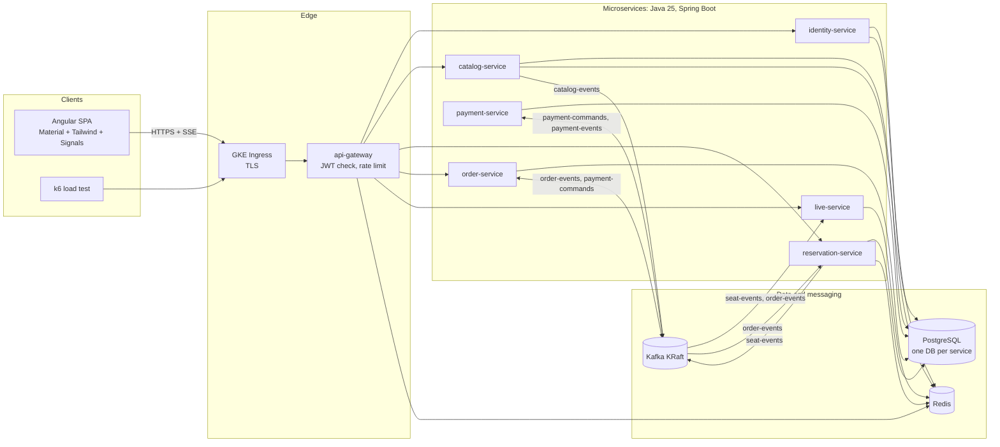
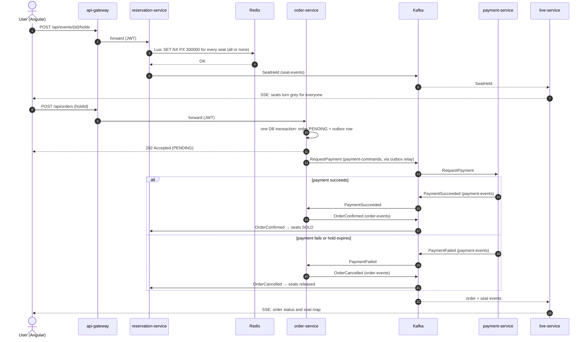
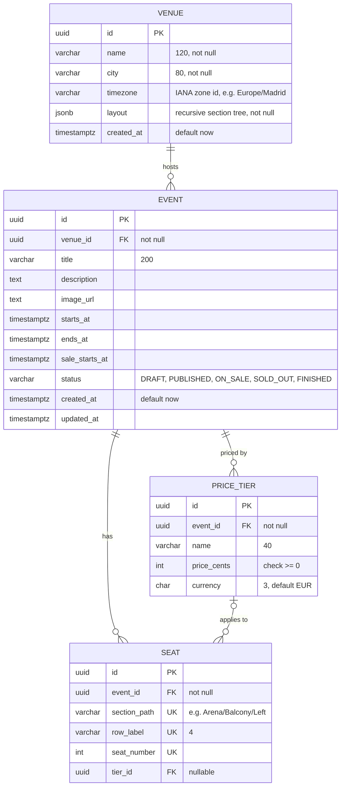

# Dropline architecture

> Status: v0 (Phase 0). Updated as each phase lands. Decisions are recorded in [`adr/`](adr/).

## 1. Product pitch

**Dropline is a ticket flash-sale platform: thousands of people try to grab a limited set of seats at the same moment, and nobody is ever double-sold.**

A "drop" opens at a scheduled time. Visitors browse events, watch a live seat map, hold up to 4 seats for 5 minutes, and check out. The payment can succeed, fail or time out; in every case the seats end up either sold to exactly one person or released back to everyone, and every open browser sees the change within a second.

The product is deliberately small (4–5 screens) so the interesting part is the engineering:

| Problem | How Dropline solves it |
|---|---|
| Thousands of users click "hold" on the same seats in the same second | Atomic multi-seat holds in **Redis** (Lua script, TTL) + a **PostgreSQL** unique index as the final guard |
| Checkout spans several services (hold → order → payment → confirm/release) | A **saga** coordinated through **Kafka** events, with a **transactional outbox** |
| Event pages are hammered right before a drop | **Redis** cache-aside + per-user **rate limiting** at the gateway |
| Everyone must see seats disappear live | Kafka → live-service → **Server-Sent Events** → Angular **signals** |
| Some services need to scale during a drop | **Kubernetes** (GKE) with a Horizontal Pod Autoscaler |

## 2. Services

Six Spring Boot services (Java 25) behind one gateway. Each service owns its own database; services never read each other's tables.

| Service | Responsibility (one line) | Owns | Talks via |
|---|---|---|---|
| **api-gateway** | Single entry point: routing, JWT check, per-user rate limiting, CORS | Redis rate-limit buckets | HTTP |
| **identity-service** | Users, roles and hashed passwords; issues JWTs (Spring Authorization Server) | `identity` DB | HTTP |
| **catalog-service** | Venues, events, price tiers, seat layouts, the events calendar | `catalog` DB, Redis cache | HTTP, produces `catalog-events` |
| **reservation-service** | Seat availability and time-limited holds; marks seats sold or released | `reservation` DB, Redis holds | HTTP, produces `seat-events`, consumes `order-events` |
| **order-service** | Orders and the checkout saga (orchestrator), transactional outbox | `orders` DB | HTTP, produces `order-events` + `payment-commands`, consumes `payment-events` |
| **payment-service** | Mock payment provider: random latency and failures, idempotent per order | `payments` DB | Kafka only |
| **live-service** | Pushes seat and order updates to browsers over SSE | Redis pub/sub | SSE, consumes `seat-events` + `order-events` |

> The original plan listed 5 services + gateway; **identity-service** was added in Phase 5 (Spring Security). See the Trello list "Phase 5 – Security".

## 3. Architecture diagram



GCP managed services (Cloud Storage, Cloud Run functions, Secret Manager, Cloud Logging/Monitoring/Trace) are added in Phases 5–7; see the [Miro system design board](https://miro.com/app/board/uXjVELYA8O8=/).

## 4. Checkout saga



Rules that make the saga safe:

- **Transactional outbox:** order-service never writes to the DB and publishes to Kafka as two separate steps. The event is written to an `outbox` table in the same transaction and a relay publishes it.
- **Idempotent consumers:** every consumer records processed message IDs, so Kafka redeliveries are harmless.
- **Dead-letter topics:** a message that keeps failing goes to `<topic>.DLT` instead of blocking the partition.
- **Double safety on seats:** Redis is the fast gate; a PostgreSQL partial unique index on `(event_id, seat_id)` for `HELD`/`SOLD` rows is the source of truth.

## 5. Kafka topics

Topic definitions live in [`infra/kafka/topics.txt`](../infra/kafka/topics.txt) and are created by the `kafka-init` Compose service running [`infra/kafka/create-topics.sh`](../infra/kafka/create-topics.sh) (idempotent). In Phase 6 they become Strimzi `KafkaTopic` resources.

| Topic | Partitions | Key | Producer → consumers | Message types | Why this key |
|---|---:|---|---|---|---|
| `seat-events` | 6 | `eventId` | reservation → live | `SeatHeld`, `SeatReleased`, `SeatSold` | All changes to one event's seat map stay in order; 6 partitions spread hot drops across consumers |
| `order-events` | 3 | `orderId` | order → reservation, live | `OrderCreated`, `OrderConfirmed`, `OrderCancelled` | Preserves the order lifecycle sequence |
| `payment-commands` | 3 | `orderId` | order → payment | `RequestPayment` | Commands for one order are processed in order |
| `payment-events` | 3 | `orderId` | payment → order | `PaymentSucceeded`, `PaymentFailed` | Results for one order arrive in order |
| `catalog-events` | 1 | `eventId` | catalog → (cache/timeline refresh) | `EventPublished`, `EventUpdated` | Low throughput; one partition keeps global order |

- Every application topic has a dead-letter topic `<name>.DLT` (1 partition).
- Retention: 7 days. Local replication factor: 1.
- Auto topic creation is disabled; topics only exist if they are in `topics.txt`.
- Messages use a versioned JSON envelope; see [ADR-0002](adr/0002-kafka-kraft-event-backbone.md):

```json
{ "id": "uuid", "type": "SeatHeld", "version": 1, "occurredAt": "2026-12-04T19:00:00Z", "payload": { } }
```

## 6. Redis usage

Redis plays four different roles. Each has its own key prefix so they never collide.

| Pattern | Used by | Keys | Commands / mechanism | TTL | Why Redis |
|---|---|---|---|---|---|
| **Seat holds** (distributed lock) | reservation-service | `hold:{eventId}:{seatId}` → `userId` | Lua script: check all seats free, then `SET ... NX PX 300000` for each (all or none) | 5 min | Atomic, sub-millisecond, expiry built in |
| **Cache-aside** | catalog-service | `catalog::events:detail::{id}`, `catalog::events:list::{filterKey}`, `catalog::calendar:month::{yyyy-MM}` | Spring `@Cacheable` / `@CacheEvict`, JSON values | 60 s – 5 min | Protects PostgreSQL from read spikes before a drop |
| **Rate limiting** | api-gateway, identity-service | gateway token buckets per user/IP; `login:fail:{email}` | Spring Cloud Gateway `RequestRateLimiter`; `INCR` + `EXPIRE` for failed logins | seconds – 15 min | Shared counters across gateway replicas |
| **Pub/sub fan-out** | live-service | channel `live:event:{eventId}` | `PUBLISH` / `SUBSCRIBE` | none (fire and forget) | Any replica can push to any connected browser |

If Redis is down, the cache falls back to the database; holds and rate limiting fail closed (no hold is granted without Redis).

## 7. Data ownership

| Database | Owner | Main tables |
|---|---|---|
| `catalog` | catalog-service | `venue`, `event`, `price_tier`, `seat` |
| `reservation` | reservation-service | `seat_state` (+ partial unique index) |
| `orders` | order-service | `orders`, `order_line`, `outbox`, `processed_messages` |
| `payments` | payment-service | `payment`, `processed_messages` |
| `identity` | identity-service | `app_user` (hashed passwords), `role`, `user_role`, OAuth2 tables |

All five databases run on one PostgreSQL instance locally and in GKE; each service has its own user that can only connect to its own database (see [ADR-0001](adr/0001-database-per-service-one-postgres.md) and Trello bug H-01).

### 7.1 Catalog schema (catalog-service)

Source of truth: [`V1__catalog_schema.sql`](../backend/catalog-service/src/main/resources/db/migration/V1__catalog_schema.sql), applied by Flyway (`ddl-auto=validate`, Hibernate never creates tables).



| Constraint / index | Purpose |
|---|---|
| `uq_seat_event_location` UNIQUE (`event_id`, `section_path`, `row_label`, `seat_number`) | A physical seat exists once per event |
| `idx_event_status_starts_at` on `event(status, starts_at)` | Event list and calendar queries ("upcoming, on sale") |
| `idx_seat_event_id` on `seat(event_id)` | Load all seats of an event (layout, seat counts per tier) |
| `CHECK status IN (...)` | Only valid event states |
| `CHECK price_cents >= 0` | Prices stored as integer cents, never floating point |

`venue.layout` is a recursive tree (a node has either `children` or seats), walked recursively by `LayoutWalker` (P1-03) to generate `seat` rows and their `section_path`:

```json
{ "name": "Arena", "children": [
  { "name": "Floor", "tier": "FLOOR", "rows": ["A", "B", "C"], "seatsPerRow": 20 },
  { "name": "Balcony", "children": [
    { "name": "Left",  "tier": "BALCONY", "rows": ["D", "E"], "seatsPerRow": 12 },
    { "name": "Right", "tier": "BALCONY", "rows": ["D", "E"], "seatsPerRow": 12 } ] } ] }
```

Seat **availability** (free / held / sold) is not stored here: it belongs to reservation-service's own database (`seat_state`), linked only by `seat_id`.

## 8. Decision records

| ADR | Decision |
|---|---|
| [0001](adr/0001-database-per-service-one-postgres.md) | Microservices with database-per-service on one PostgreSQL instance |
| [0002](adr/0002-kafka-kraft-event-backbone.md) | Kafka (KRaft) as the event backbone; JSON envelope now, Avro later |
| [0003](adr/0003-gcp-gke-over-aws-eks.md) | GCP/GKE over AWS/EKS |
| 0004+ | Phase 1 decisions (Maven, Redis cache, signals, Tailwind, AVL tree), added in P1-19 |
